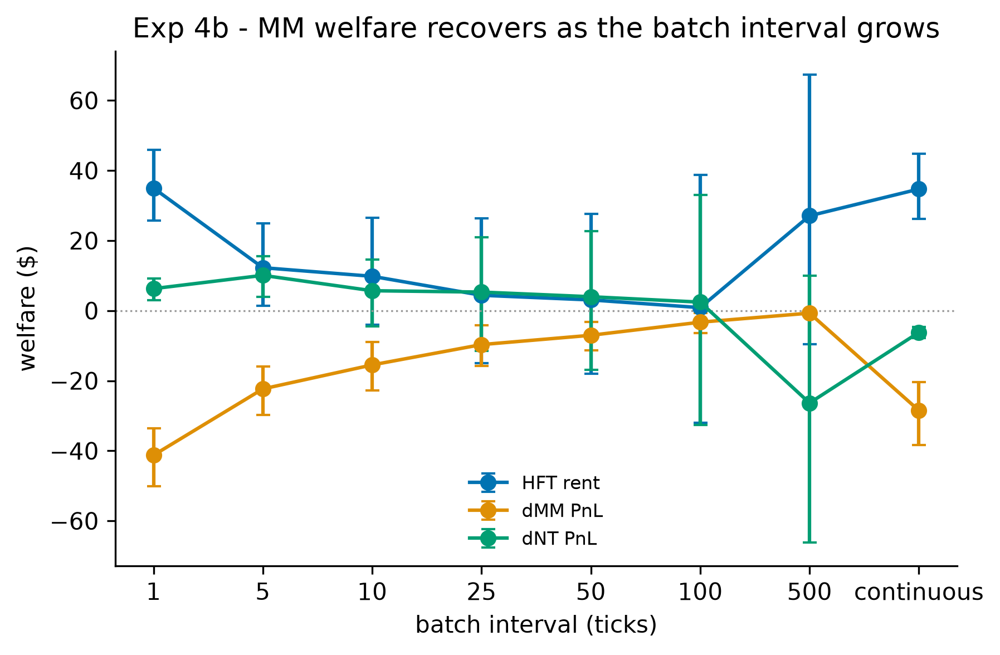

# Supplement to "Who Bears the Latency Tax?"

**Atharva Patil**

This supplement holds material moved out of the main text after review: results demoted from the main text, each with the reason (S1); robustness and validity checks, calibration and measurement details, and the full limitations (S2); the engine's verification record (S3); and replication details (S4). Section, table and figure labels prefixed "S" are internal to this supplement; unprefixed ones (§4.2, Table 1) point to the main paper.

## S1. Demoted results

### S1.1 Experiment 1: the positive rent and the 3×3 grid

*Why demoted.* At the operating point a positive HFT rent is positive by construction: a sniper fires only when the fundamental is further from the maker's stale quote than its transaction cost (zero here), and the maker's three-tick latency guarantees such gaps occur. A positive rent therefore checks the harness rather than testing a hypothesis about the market. The noise-trader share of the transfer, previously reported as an 18%/82% split against the maker, is dropped as a headline; the underlying deltas are in Table S1.

Within the conserved frame of §4.3, HFT entry extracts a rent of 34.70 [26.25, 44.80] per run. Maker PnL changes by −28.50 [−38.31, −20.35] relative to the matched no-HFT baseline (from 101.27 [93.28, 110.72] to 72.78 [71.05, 74.38]) and noise-trader PnL by −6.21 [−7.87, −4.61]. Liquidity gaps rise from 2.84 [2.47, 3.26] in the baseline to 9.70 [9.15, 10.27] in treatment, a delta of 6.86 [6.20, 7.52]; the baseline is not gap-free, reflecting quote churn with no HFT present. Lagged Kyle's λ, the price impact per unit of signed flow (Kyle, 1985), rises about sevenfold, from 0.200 [0.184, 0.216] to 1.372 [1.361, 1.383].

Varying the maker's adverse sensitivity and spread decay over {0.05, 0.1, 0.2} × {0.05, 0.1, 0.2} with $n=100$ seeds per cell, HFT rent is significantly positive and the zero-sum identity holds in all nine cells, with rent point estimates from 16.56 to 46.63 (`exp1_hardening.json`, `calibration`).

**Table S1.** Experiment 1 welfare and microstructure estimates at the operating point ($n=100$ seeds; point estimate with 95% bootstrap CI). PnL, rent and residual in simulation currency (§3.4).

| Quantity | Treatment | No-HFT baseline | Treatment − baseline |
|---|---|---|---|
| HFT rent | 34.70 [26.25, 44.80] | — | — |
| MM PnL | 72.78 [71.05, 74.38] | 101.27 [93.28, 110.72] | -28.50 [-38.31, -20.35] |
| NT PnL | -107.48 [-116.84, -99.26] | -101.27 [-110.72, -93.28] | -6.21 [-7.87, -4.61] |
| Zero-sum residual | 2.78e-12 [-3.34e-12, 9.11e-12] | -5.39e-12 [-2.16e-11, 1.05e-11] | — |
| Liquidity gaps (count per run) | 9.70 [9.15, 10.27] | 2.84 [2.47, 3.26] | 6.86 [6.20, 7.52] |
| Lagged Kyle's $\lambda$ | 1.372 [1.361, 1.383] | 0.200 [0.184, 0.216] | — |

### S1.2 Liquidity gaps grow with the number of snipers; the channel is unidentified

*Why demoted.* The review asked that the liquidity-gap channel be identified or the result deleted. It has not been identified, so the result is reported here and the main text keeps one sentence on it.

Liquidity gaps (§3.3; full definition in S4) rise steadily with the number of HFTs $k$ at the operating point, from 2.84 [2.47, 3.26] at $k=0$ to 47.47 [46.22, 48.85] at $k=21$, about 16.7-fold. The growth is close to linear in $k$ (fit over $k \geq 1$: slope 2.13, intercept 3.74, $R^2=0.997$; `exp3_hft_count.json`). The maker's depth-thinning rule — its resting size shrinks as its spread widens — is the obvious mechanical explanation, and it is not the explanation: re-running the sweep with the rule off and quote size held constant ($n=100$, `exp3_hft_count_fixed_depth.json`) leaves the growth unchanged, gaps running from 3.61 at $k=1$ to 47.18 at $k=21$ with a fitted slope of 2.18 ($R^2=0.998$). Thinning adds about one and a half gaps at small $k$ and nothing to the slope. Nor is the growth a count of snipes: HFT fills stay flat (252 to 242 at fixed depth) while gaps rise thirteenfold, the book is sampled once per tick, and losing HFT orders are IOC and leave nothing behind. We report the growth as a regularity with an unexplained mechanism.

Gaps also move with the batch-clearing interval. At the operating point the per-tick auction produces about 137 gaps per run against 9.7 under continuous clearing (`exp4_batch_auction.json`). At calibrated parameters the batch arm is non-monotone in the interval, the per-tick auction being the worst cell on both rent elimination and gaps (Figure S1).

### S1.3 Per-maker winners by latency configuration

*Why demoted.* These are cell counts over one grid. Neighbouring cells share seeds and differ by one step in HFT count or snipe ratio, so a count of cells is not a count of independent replications, and the review rejected it as evidence. The main text replaces the count with a held-out prediction test of who wins (§4.2, to be added). The table below is kept as a description of the grid.

Each maker's PnL delta is bootstrapped separately at the eighteen tape-band cells (ratios 0.0049 and 0.0097 × nine HFT counts), $n=100$, maximum residual $5.57\times10^{-10}$ (`exp7b_per_maker_pnl.json`, `exp7d_latency_permutation_values.json`). A verdict is "gains" or "pays" at 95% bootstrap confidence.

**Table S2.** Tape-band cells (of 18) in which each maker gains or pays, by latency configuration.

| makers' latencies (ticks) | fastest gains | middle gains | slowest pays |
|---|---|---|---|
| 0, 5 (zero-latency leader) | 18 | — | 18 |
| 0, 3, 5 (zero-latency leader) | 18 | 18 | 18 |
| 1, 5 (calibrated) | 14 | — | 15 |
| 2, 6 | 11 | — | 14 |
| 1, 4 | 15 | — | 17 |
| 1, 3, 5 (calibrated) | 4 | 18 | 13 |
| 1, 4, 7 | 6 | 18 | 14 |
| 2, 3, 4 | 6 | 3 | 3 |

With a zero-latency leader the ordering is monotone in latency. With latencies spaced as measured replenishment spaces them, it is not. At two makers the faster usually gains, but the order reverses at thirteen or more snipers. At three makers without a zero-latency leader the fastest never wins consistently: the middle maker gains in all eighteen cells under {1, 3, 5} and {1, 4, 7}, while under the closely spaced {2, 3, 4} the slowest gains most often, in 10 of 18, and the middle maker pays in 14. Neither speed rank nor a particular tick value predicts the winner — three ticks wins under {1, 3, 5} and mostly pays under {2, 3, 4}.

### S1.4 The Hawkes endogeneity diagnostic: a placebo-validated null

*Why demoted.* A null at an operating point whose arrival processes are close to Poisson by construction says little about the mechanism, and the diagnostic is about the liquidity-gap channel demoted in S1.2.

The diagnostic asks whether the liquidity gaps are preceded by rising order-flow self-excitation — whether they are reflexive cascades rather than direct consequences of adverse-selection widening. We estimate the branching ratio of a self-exciting Hawkes process on simulated order flow (Filimonov and Sornette, 2012) in 200-tick windows labelled pre-gap or normal, on both the trade and quote-update processes, with a placebo arm whose gap labels carry no information. Each arm is 10 simulations of 50,000 ticks at the operating point, with a 50σ shock every 2,500 ticks (`exp5_redesigned.json`, `config`). The windowing, labelling, and placebo construction are in the replication materials.

**Table S3.** Hawkes branching ratios $n(t)$ in pre-gap and normal windows.

| Arm / process | pre mean $n(t)$ | normal mean $n(t)$ | $p$ (one-sided) | rank-biserial | $n_{\text{pre}}$ / $n_{\text{normal}}$ (windows) |
|---|---|---|---|---|---|
| Treatment / trades | 0.0162 | 0.0167 | 0.258 | 0.012 | 1,416 / 3,614 |
| Treatment / quotes | ≈0 | ≈0 | 0.937 | −0.029 | 1,260 / 3,206 |
| Placebo / trades | 0.0111 | 0.0168 | 0.895 | −0.038 | 373 / 8,614 |
| Placebo / quotes | ≈0 | ≈0 | 0.491 | 0.001 | 335 / 7,707 |

The result is a null, and the placebo shows the pipeline does not manufacture endogeneity where none exists. Pre-gap and normal branching ratios are indistinguishable on trade arrivals ($p=0.258$, effect size 0.012), and the quote-update process shows essentially no self-excitation anywhere, as expected when the maker's requotes track an exogenous random walk. At this operating point the gaps are not preceded by rising self-excitation. This is not evidence against reflexivity in real markets, where self-excitation is well documented: this market's arrival processes are close to Poisson by construction, with branching ≈0.017 on trades, some 50× below criticality, leaving little endogeneity to detect.

A real-data leg would run the same pipeline on the BTC tape. It needs one new component, a depth-depletion definition of a gap suited to a book that never empties (e.g., top-k depth falling below a percentile floor), after which the windowing, labelling, and placebo machinery apply unchanged.

## S2. Robustness and validity checks moved from the main text

### S2.1 Calibration details (§3.6)

To discipline the operating point against real microstructure, we calibrate the sim's *environment* parameters to Binance BTCUSDT-perpetual order flow recorded by a companion collector (20-level book snapshots at ~10/s and the aggregated-trade stream; trade timestamps are whole milliseconds, not nanoseconds as an earlier draft said — see S6). The collector drops a few hours on most days (host sleep), which we handle by making each moment gap-safe rather than by discarding gapped days: arrival intensity accumulates each hourly file's own observed span, so missing hours leave the denominator instead of inflating it, and realized volatility keeps only returns between *adjacent* one-second buckets, so no return straddles a gap. Days enter at 18 hours of coverage in both streams; files truncated by a mid-write crash are skipped and recorded. A whole-day span over a 21/24 day biases the arrival rate down by roughly 12%, and demanding 24/24 coverage admits only two of the days the collector has ever produced. Under the gap-safe estimators the sample is 27 days (2026-06-24 to 2026-07-21, less 2026-07-19; 37.0M trades, 4.16M snapshots, 2.27M seconds of coverage), yielding: trade arrival 16.28/s; trade sizes p50/p90/p99 of 0.003/0.177/2.01 BTC; median spread of one exchange tick (≈0.016 bp); median top-of-book depth 6.18 BTC; and 1-second realized volatility of 0.650 bp/√s.

The mapping between sim ticks and wall-clock is a modelling choice we fix at 1 tick = 100 ms: the market maker's 3-tick latency then means 300 ms of quote staleness — slow but plausible — while HFTs react within a tick, preserving the BCS fast/slow asymmetry at realistic crypto scales. Under that convention two environment parameters invert directly, and both fits verify by simulation. The volatility inversion matches: at fitted $\sigma$ the baseline's simulated realized vol is 0.647 vs the target 0.650 bp/√s. The arrival inversion is not: its closed form assumes every noise order trades, but only about half the IOCs find a quote at the operating point, so the fit iterates the arrival intensity against the *simulated* trade rate to a fixed point (converging in three steps from a closed-form 0.204 to 15.94 vs 16.28/s). The fitted values are a per-tick arrival probability of 0.427 and $\sigma$ = 20.6 against the pre-registered operating point's 0.15 and 20.

Estimated over the full month the fitted $\sigma$ lands within 3% of the value the experiments were pre-registered at, so on volatility the operating point is not data-adjacent but data-consistent. A two-day subsample passing a stricter 24/24 completeness filter gives 55.7 — nearly three times as large — because those two days were simply hot (1.76 bp/√s against the 27-day 0.650), which is the kind of sampling artifact a small clean-data-only window invites. Arrival intensity remains under-set: the fitted per-trader rate is 2.8× the operating point's, so the supporting experiments (§4.3) run on a market thinner in order flow than the perp, and §4.4 re-runs the full grid at the fitted parameters.

That re-run required re-calibrating one agent parameter, for a reason that generalizes to any transplant of a tuned agent into a calibrated environment. The maker's widening is applied *per adverse fill event* (each adverse fill multiplies the half-spread by one plus the sensitivity), so it is not scale-free in order flow: tripling the arrival rate triples the multiplicative kicks per tick while the decay pulling the spread back to base is unchanged. Measured directly, the maker's pickoff rate rises from 0.20 to 0.86 per tick between the operating point and calibrated flow, and at the pre-registered adverse sensitivity of 0.1 the *no-HFT* spread settles at 5.36× base — the maker widens to its cap with no informed trader in the market at all. Any experiment run in that state would credit a control-loop artifact to the arms race. The stationary spread multiple obeys $m = (1 - P\ln(1+s)/d)^{-1}$ for pickoff rate $P$, sensitivity $s$ and decay $d$, which predicts 5.56× at $P=0.86$ against the 5.36× observed and 1.24× at $P=0.20$ against 1.17×; solving it for the original calibration target locates the replacement value, and a re-run of the sensitivity–decay grid of S1.1 under calibrated flow confirms it. We therefore set the adverse sensitivity to 0.015 for the calibrated runs, holding spread decay at its pre-registered 0.1 so that exactly one parameter moves, selected on the same criterion as the original (no-HFT spread ≈1.1× base with positive with-HFT divergence: 1.12× and +0.08, against 1.14× and +0.03 for the published cell). The 6.7× reduction in sensitivity tracks the 4.3× rise in pickoff rate, as per-event widening implies.

Two further parameters are not pinned by the data. The snipe size is set to the calibrated quote size (2061 units), preserving the operating point's ratio of 1.0 so that a single snipe still clears the top quote — the mechanism the race runs on; holding it at 50 instead makes a snipe take 2.4% of the book, which changes the experiment rather than rescaling it, and we report that arm separately as a robustness check. The minimum quote size is left at 1 and is inert at calibrated depth: the thinning floor is set by the spread cap, with the maker bottoming out well above the nominal floor in every calibrated cell.

The calibration does not fit everything. Spread and depth levels are not fitted: the stylized MM quotes a ~1.5 bp median spread where the perp trades at ~0.016 bp, and its depth-to-median-trade ratio is 5× against the perp's ~2060×. The size distribution is not fitted in the experiments of §4: sim order sizes there are constants while real sizes are heavy-tailed (p99/p50 ≈ 670×). A lognormal size model for the calibrated re-run is implemented and parameterized ($\sigma_{\ln} = 2.80$ fitted on the p50/p99 ratio; median 1 unit with a calibrated book depth of ~2061 units, matching the real depth-to-median-trade ratio), with the disclosed compromise that a two-quantile lognormal under-predicts the p90 size ratio, 36× against the observed 59×. And the latency/race structure is not estimable from any public crypto feed — measuring races requires failed-order message data of the kind Aquilina, Budish, and O'Neill (2022) obtained from a regulator — so HFT latency and the race remain swept design parameters throughout. The calibrated claim is therefore narrow: the *environment* the agents trade in (arrival intensity, fundamental volatility) is disciplined by data; the strategic structure is designed, not estimated.

### S2.2 Tape measurement details (§3.7)

*Superseded.* The ratio this section describes was computed under the spot market's aggregation rule, one record per taker order and price level, which futures records do not follow; the corrected race-size distribution is in §3.9 and Table S11. The text is kept as the record of the earlier measurement.

The distribution is extremely right-skewed, which is why the surface sweeps as far as ratio 1.0. On the collector's current 105-hour sample the unconditional quartiles are p25 0.0011 and p75 0.0493 around a median of 0.0068, with the race-proxy median stable to 0.3%, so nothing in §4.1 turns on the sample boundary. Full alignment rules, the sweep de-fragmentation and aggressor-attribution corrections, and the placebo construction are in the replication materials (Supplement S4).

### S2.3 Checks on the incidence surface (§4.1)

**Validity: the surface nests the published cells rather than re-specifying the environment.** Because a new grid could differ from the published calibrated runs for uninteresting reasons, the ratio axis is swept as integer snipe *quantities* so that two cells coincide exactly with results already reported. The ratio-1.0 column reproduces the calibrated Experiment 3 run to every quoted digit — rent 85,721 / 85,163 / 84,375 / 83,262 / 81,469 / 78,696 / 74,261 and liquidity gaps 32.05 / 42.19 / 52.73 / 74.19 / 106.51 / 151.08 / 217.78 across k = 1 … 21 — and the ratio-0.0243 row reproduces the 50-unit-snipe arm of §4.1 to the digit, including the maker's +1,327 delta at k=1 and −5,213 at k=21. The zero-sum residual is machine zero in all 63 cells (largest 5.6×10^−10 against rents of order 10^4–10^5), so the accounting closes here as it does in every other result.

**A secondary regularity: the noise-trader toll is nearly invariant.** Across all 63 cells the noise traders' delta stays within −1,699 to −3,410, a factor of two, while the maker's delta swings from +2,154 to −84,023, a factor of forty in magnitude and a change of sign. The maker's exposure is therefore essentially the whole source of variation on this surface. Noise traders pay a roughly fixed toll for transacting against a latency-disadvantaged maker in the presence of snipers, and what the ratio and the count determine is whether the maker adds to that toll or collects part of it.

**The near-invariance is what inelastic demand predicts.** Noise-trader arrival in §4.1 does not respond to the spread: each agent crosses with a fixed probability per tick whatever the maker is quoting (§3.2), so a near-constant toll across 63 cells is the signature that assumption leaves. Volume is pinned by construction, so the only channel through which widening can reach the noise traders is the price paid per crossing, and the factor-of-two range is that channel operating alone. We therefore cannot separate the reading in which the toll is invariant for economic reasons from the reading in which the model gives it no margin on which to vary. §4.2 supplies the missing margin by making arrival elastic in the quoted half-spread, and finds the incidence unmoved.

**A negative result: the surface does not reduce to one dimension.** The boundary invites an obvious simplification — that only aggregate snipe pressure matters, so incidence should turn on the product of ratio and count rather than on each separately. At the flips the product ratio × k lies in a narrow band, roughly 0.10–0.20, which makes the reduction look right. We tested it and it fails. At ratio 0.0097 with k=21 the product is 0.204 and the maker still gains significantly; at ratio 0.0243 with k=7 the product is 0.170 — smaller — and the maker no longer gains. A single product threshold cannot order those two cells, so the near-collapse is a coincidence of the grid rather than a law, and the structure is two-dimensional. We report no product rule. The mechanism is presumably that snipe size and sniper count act through different channels — size determines how much of the quote a single race removes, count determines how often the quote is stale when a race starts — and the maker's widening response is not linear in either.

### S2.4 Elastic demand (§4.2)

**Elastic demand.** The second fixed assumption is that noise traders cross at a fixed per-tick probability whatever the maker quotes. The objection this licensed — elasticity withdraws the flow that finances the maker's gain — rests on a premise §4.1's leg decomposition already refuted: the revenue leg is *already negative*, and the gain comes from the sniping leg shrinking. Elasticity therefore deepens a leg already working against the maker without touching the dominant channel, making the question quantitative. We set $\lambda_{\text{eff}} = \lambda (s_{\text{base}}/s)^{\alpha}$ with $s$ read off the book, so arrivals match §3.6's fitted intensity at base spread for every $\alpha$ and only the response to widening changes, and re-run the full surface at $\alpha \in \{0, 0.5, 1.0\}$ (189 cells). The $\alpha=0$ path short-circuits before the book is read, preserving the RNG stream: it reproduces §4.1 to 0.0 absolute difference on rent and the zero-sum residual at all three probes, with maximum residual $1.14\times10^{-8}$ and baseline trades falling 5,165 → 4,902 → 4,657, confirming the knob engages.

This surface is at $n=20$, so its $\alpha=0$ row differs slightly from the $n=100$ single-maker figures of §4.1 (flip at $k=7$, rent 84,375; Table 5 of the main text); comparisons across $\alpha$ are within the one run. The maker-gains region survives. Eighteen of eighteen tape-band cells gain inelastically and **seventeen at both mild and unit elasticity**; the single loss, ratio 0.0097 at $k=21$, turns *indeterminate* rather than maker-pays ($+215$ $[-202, 672]$ at $\alpha=1.0$), and no band cell classifies as maker-pays at any elasticity tested. The lower band edge is untouched, the 0.0243 boundary retreats one grid step, and the effect saturates between $\alpha=0.5$ and $\alpha=1.0$ rather than scaling. On a revenue-capture account unit elasticity should have removed the gain, since it removes a tenth of noise participation when the maker widens. Noise traders do withdraw as the objection predicted — their loss shrinks from $-2{,}667$ to $-2{,}033$ — which buys them partial self-protection but does not move the incidence.

### S2.5 Supporting experiments: figures and tables (§4.3)

Experiment 2 sweeps the market maker's staleness — the latency with which it observes the fundamental — holding the HFTs at zero latency, and asks how the transfer scales. The question matters for the incidence surface: a boundary mapped across a mechanism containing a discontinuity would be an artifact of the discontinuity rather than a boundary.

![Figure S2. Experiment 2: HFT rent against the maker's staleness, with the linear fit and the first significant staleness marked. The rent axis is simulation currency, not dollars as the image's "$" label says; the staleness axis is in simulated microseconds, 1,000 per tick. This image was generated from the superseded $n=20$ run, so its points and its legend slope (10.8 per tick) are the $n=20$ values; the $n=100$ fit used in the text is 10.46 per tick. [TODO: regenerate with `analysis/exp2_figures.py` from the $n=100$ results.]](../results/figures/fig2a_hft_rent.png)

At $n=100$ rent rises with staleness at approximately 10.46 units of simulation currency per tick, and the relationship is smooth: comparing a linear specification against a segmented one with a free breakpoint gives $\Delta\mathrm{BIC} = -0.17$, a magnitude well inside the range of indifference, so the data do not discriminate between them. We read this as no detectable knee, not as positive support for linearity. Rent first becomes statistically distinguishable from zero at roughly two ticks of staleness, which is the detectability floor of this grid rather than a property of the mechanism, since latency resolves only at tick granularity here (§6.2).

The welfare decomposition closes at every point on the sweep, and the HFT fill rate rises with staleness: a staler maker is picked off more often. Per-cell values across the sweep are in the replication materials (S4); the figure carries the shape, which is what the incidence argument uses.

**Table S4.** Experiment 3: per-HFT and total rent, fill rate and liquidity gaps by HFT count $k$ at the operating point ($n=100$ seeds; point estimate with 95% bootstrap CI).

| $k$ | Per-HFT rent | Total rent | Fill rate | Liquidity gaps |
|---|---|---|---|---|
| 0 | — | — | — | 2.84 [2.47, 3.26] |
| 1 | 34.82 [26.40, 44.84] | 34.82 [26.40, 44.84] | 0.2886 [0.2863, 0.2909] | 5.27 [4.91, 5.65] |
| 2 | 17.46 [13.28, 22.43] | 34.93 [26.55, 44.87] | 0.1448 [0.1437, 0.1460] | 7.79 [7.31, 8.29] |
| 3 | 11.57 [8.75, 14.93] | 34.70 [26.25, 44.80] | 0.0964 [0.0957, 0.0971] | 9.70 [9.15, 10.27] |
| 5 | 6.77 [5.07, 8.81] | 33.83 [25.36, 44.03] | 0.0578 [0.0574, 0.0583] | 14.92 [14.27, 15.61] |
| 8 | 4.31 [3.23, 5.60] | 34.50 [25.84, 44.76] | 0.0362 [0.0359, 0.0365] | 21.09 [20.20, 21.99] |
| 13 | 2.65 [1.97, 3.45] | 34.43 [25.63, 44.87] | 0.0223 [0.0222, 0.0225] | 32.79 [31.73, 33.91] |
| 21 | 1.60 [1.21, 2.07] | 33.70 [25.39, 43.45] | 0.0139 [0.0137, 0.0140] | 47.47 [46.22, 48.85] |

### S2.6 The tick model's limitations (superseded)

These were the earlier version's limitations, kept as its record. The event model replaces the 100 ms clock and adds fees (§3); the main text's §6.2 states the limitations that remain.

**First, the elasticity of uninformed demand is the assumption the incidence result leans on hardest, even now that it is measured.** Noise traders cross at a fixed per-tick probability in every arm through the competition surface (§3.2), so the volume a maker earns its widened spread on cannot fall when it widens. §4.2 relaxes this to unit elasticity and the maker-gains region largely remains: eighteen of eighteen tape-band cells gain inelastically and seventeen at both mild and unit elasticity ($n=20$), the single loss turning indeterminate rather than maker-pays, with the 0.0243 boundary retreating one grid step and the lower band edge untouched. That resolves the limit in the direction §4.1's leg decomposition predicts — elasticity deepens an already-negative revenue leg without touching the loss-reduction channel that produces the gain — but it does not eliminate it. Elasticity above unit is untested, as is its interaction with the maker-count axis, where the within-class split has not been tested against elastic demand at all.

**Third, the ratio measured on the tape and the ratio swept in the simulation are not the same object.** The tape's 0.0072 is a snipe against *aggregate* top-of-book depth — every maker resting at that level — whereas the simulation measures it against *one* maker's quote. The per-maker ratio is therefore bracketed below by the tape ratio and above by the tape ratio times the number of makers at the touch, a count no public feed reports, since depth arrives pre-aggregated with no maker identifiers. This matters because the inversion is a statement about the per-maker ratio: if the true value sits above the boundary at the relevant HFT count, the maker bears the tax after all. §4.2 resolves the bracket in the direction it warned of — splitting aggregate depth across $M$ makers multiplies each maker's own ratio by $M$, and the maker-gains region at the tape band is all but gone at $M=2$ (three of eighteen cells, at the lowest HFT counts) and gone at $M=3$ — so what remains unobservable is $M$ itself, and the question is now how many makers rest at the touch rather than which quantity the simulation sweeps. We apply no deflated-Sharpe-style multiple-testing correction at the cell level, because the surface reports every cell of a grid fixed before the runs rather than the survivors of a search, and a complete map selects nothing.

**Fourth, the model's clock and its costs are coarse exactly where the rents are small.** One tick is 100 ms (§3.6), a convention the calibration data forces: the book snapshots from which maker replenishment latencies are measured arrive every 100 ms. But races on real venues are decided in microseconds (Aquilina, Budish, and O'Neill, 2022) and crypto market makers react in milliseconds, so the model cannot represent the race its flow is calibrated against at the race's own resolution. Arrival intensity and volatility could be refit at 10 ms from the millisecond trade timestamps; maker latency at that resolution cannot be measured from this collector and would have to be assumed. Fees are absent altogether. Binance's standard schedule for USDT-margined futures charges about 2 bp to makers and 5 bp to takers, lower at higher tiers and with maker rebates under its market-maker programmes — the same order as, or larger than, the 0.089–4.42 bp rents of §4.4. A fee schedule enters every leg of the decomposition: it taxes the snipers' IOCs and the noise traders' crossings, and charges or pays the maker per fill depending on tier, so it could move both the size of the rent and which participant nets positive. We have not modelled it, and every incidence result here is gross of fees.

## S3. Engine verification

### S3.1 Engine configuration

All trades in the continuous arm are produced by one C++ matching engine, `OrderMatcher::MatchingEngine`, the same object that is the subject of the project's TLA+ specification suite. In the BCS harness the engine is run in **synchronous** mode: `EngineHarness::start()` calls `engine_.start()` rather than `startAsync()`, so `submitOrder()` dispatches matching on the calling thread and the `OrderBook`'s `EventListener` fires inline. Draining trades immediately after a submit therefore returns exactly the fills that order produced, which keeps the harness deterministic and free of cross-thread or GIL concerns (`bcs_research/bindings/engine_bindings.cpp`, lines 5–16). The engine offers price-time priority matching, best bid/ask, depth snapshots, VWAP, and an optional circuit breaker; the breaker is disabled in this harness via `setCircuitBreakerThreshold(1e18)` when `start(disable_circuit_breaker=True)` so that simulation control, not an exchange-level halt, governs the dynamics (lines 81–83). Prices are fixed-point: a quoted price of 100.00 is `100 * PRICE_PRECISION`, with `PRICE_PRECISION` re-exported as `bcs_engine.PRICE_PRECISION` (line 186).

**The engine has no notion of agent latency.** The comment at `engine_bindings.cpp` lines 15–16 states this explicitly: the entire BCS latency/race mechanism lives in the Python scheduler above this layer. The engine's job is only to be a correct continuous double-auction matcher, and that correctness is what the spec suite certifies.

### S3.2 The specifications

The directly relevant specification is **`Auction.tla`** (`spec/Auction.tla`), which models the engine's session lifecycle over the seven legal `TradingState`s (`PreOpen`, `AuctionOpen`, `Continuous`, `AuctionClose`, `PostClose`, `Halted`, `VolatilityAuction`) and the discrete uncross that is the only way trades emerge from an auction state. Under `Auction.cfg` (`BROKEN_NO_REOPEN=FALSE`, `MaxOrders=3`, `MaxEvents=6`, `Prices={100,200}`), TLC checks the following **invariants**:

- **`TypeOK`** — the type invariant.
- **`ValidState`** — every reachable state is one of the seven legal `TradingState`s.
- **`NoMatchOutsideContinuousExceptUncross`** — no trade prints in an auction, halt, or closed state except a discrete uncross whose source is a true auction state (`PreOpen`, `AuctionClose`, or `VolatilityAuction`). Each trade carries an `inState` history field, which the invariant checks.
- **`SingleClearingPrice`** — every uncross firing produces trades at exactly one price drawn from `Prices`. This is the code path the batch arm now clears through via the bridge's `uncross` (S3.3).
- **`NoTradeWhileHalted`** — no trade record may carry `inState=Halted`.

As temporal/action **properties** it checks **`ValidTransitions`** (`[][ state'=state \/ <<state,state'>> \in LegalEdges ]_state` — every step is either a self-loop or a legal directed edge of the session state machine) and the **liveness** property **`VolatilityEventuallyReopens`** (`)`, proved under weak fairness `WF_vars(ReopeningUncross)`). Non-vacuity is established by a companion `AuctionBroken.cfg` (`BROKEN_NO_REOPEN=TRUE`) that disables the reopening uncross so TLC reports a liveness counterexample, confirming the property is not vacuously true.

**We did not recover a model-checked state count for `Auction.tla`**: a `states/` directory and TLC trace (`.bin`) artifacts exist in the spec tree, but we did not parse them, and no state count is reported for it. The large reachable-state count cited elsewhere for the engine (§3.1) pertains to `MatchingEngine.tla` and is recorded in `docs/Verification.md`, not derived from `Auction.tla`.

`Auction.tla` sits within a broader suite (`spec/`) that verifies the surrounding engine and infrastructure. We summarize the checked properties rather than restate every configuration:

Seven further specifications cover the matching core, replication, queue, and session lifecycle; their checked properties and configuration parameters are documented in the paper's replication archive. The one number we cite in the main body is for `MatchingEngine.tla`, whose deepest exhaustive configuration (`MaxOrders=4`, `MaxTime=2`, two prices) explores 171,187,419 distinct reachable states to completion with zero invariant violations, checking `FIFOExecution` and `MatchingConservation` for the continuous cross action alongside the book-management invariants. A companion broken configuration admits non-FIFO fills so TLC returns a counterexample, establishing non-vacuity.

As a result, every artifact the simulation reports — a fill, a price, a snapshot, a zero-sum residual — is produced by a matcher whose price-time priority, FIFO preservation, non-negativity, and single-clearing-price behaviour have been model-checked, not merely tested.

The verification has two limits. TLC's guarantee is exhaustive only within the stated bounds — a handful of orders, two prices, short horizons — so it certifies the matching *design* against its invariants at bounded scope rather than proving unbounded correctness. And the object verified is the TLA+ specification, not the C++ source: no refinement proof links the two, and the correspondence rests on construction and conformance testing. Wherever this paper says "verified engine," both qualifications are attached. What the provenance buys, and what the internal-validity argument uses, is the elimination of design-level matching errors — the kind that could manufacture spurious gaps or transfers — within the checked scope, on the code path every trade in both arms traverses.

### S3.3 The bridge

A pybind11 module named `bcs_engine` bridges the verified C++ engine to Python (`engine_bindings.cpp`, `PYBIND11_MODULE` at line 212). It exposes a single entry class, `EngineHarness`, with: `add_symbol` (which must precede `start()`; `start()` freezes the book registry, after which `add_symbol` throws/no-ops, lines 64–70), `start(disable_circuit_breaker=True)`, `stop`, `submit_order(symbol, order_id, participant_id, side, price, quantity, order_type=Limit, tif=GTC)`, `submit_cancel`, `best_bid`, `best_ask` (with `INT64_MAX` normalized to 0 when the ask side is empty, lines 129–134), `mid` (0 if either side is empty), `drain_trades`, `snapshot(depth=10)`, `vwap`, `trade_count`, and — added so the batch arm clears through the engine (§5) — `uncross` (one uniform-price call-auction clearing of the resting book) together with `set_trading_state`/`trading_state` over the session states of `Auction.tla` (lines 163–189). Fills are captured by a per-symbol `TradeCollector` that buffers every trade on the book and clears on `drain_trades`; Python attributes each fill to agents by `buyer_id`/`seller_id`. The enums `Side`, `OrderType` (`Limit`/`Market`/`IOC`/`FOK`/`PostOnly`), `TimeInForce` (`GTC`/`GTD`/`DAY`), and `RejectReason`, plus read-only `Trade`, `PriceLevel`, and `MarketDataSnapshot` classes, are exposed alongside.

Python agents drive the verified engine entirely through this surface: each tick they emit orders and cancels, the scheduler submits them via `submit_order`/`submit_cancel`, and because the engine is synchronous, the scheduler drains the resulting fills inline and routes them back to the agents. The agents never touch C++ state directly; the bridge is the only channel, which is what lets the verified matcher remain the sole adjudicator of trades.

The batch arm (`BatchAuctionScheduler`) parks the book in `AuctionOpen` — where orders accumulate instead of matching on arrival — collects the window's orders, and clears through the engine's own `uncross`, the code path `Auction.tla` proves `SingleClearingPrice` over. Both arms of Experiment 4 therefore run on the same verified matcher, and the batch arm's fills are engine fills, drained through the same `TradeCollector` as continuous fills. An earlier revision cleared the batch in Python instead; §5 reports what comparing the two found.

## S4. Replication

All experiment code is in `bcs_research/`: agents in `agents/`, the latency and batch-auction schedulers in `simulation/`, metrics in `metrics/`, experiment drivers in `experiments/`, analysis scripts in `analysis/`, and the pybind11 bridge in `bindings/engine_bindings.cpp`. The engine's TLA+ specifications are in `spec/` (notably `MatchingEngine.tla` and `Auction.tla`), with the TLC state-exploration record in `docs/Verification.md`. Results are written as JSON under `bcs_research/results/experiments/`, at $n=100$ seeds and bootstrap seed 0 unless stated.

Drivers are under `experiments/` and results under `results/experiments/` unless another directory is named.

- **Experiment 1** (§4.3, S1.1): `exp1_hardening.py` → `exp1_hardening.json`; operating point `CFG` in `exp1_primary.py`.
- **Experiment 2** (§4.3, S2.5): `exp2_latency_sweep.py` → `exp2_latency_sweep.json`.
- **Experiment 3** (§4.3, Table S4): `exp3_hft_count.py` → `exp3_hft_count.json`. At fixed depth: `main(cfg={"thin_liquidity": False})` → `exp3_hft_count_fixed_depth.json`.
- **Experiment 4** (§4.3): `exp4_batch_auction.py` → `exp4_batch_auction.json`; at 50,000 ticks, `main(cfg={"duration_us": 50_000_000})` → `exp4_batch_long.json`; maker-latency arms, `main(intervals=[1], cfg={"mm_latency_us": 0})`, the same at `1000`, and `intervals=[5]` at `7000` → `exp4_batch_mm_lat0_iv1.json`, `exp4_batch_mm_lat1_iv1.json`, `exp4_batch_mm_lat7_iv5.json`.
- **Calibrated re-runs** (§4.4): `run_calibrated.py` → `*_calibrated.json`, `*_calibrated_hftqty50.json`; competing makers, `exp4_competing_makers.py` → `exp4_competing_makers.json`.
- **Incidence surface** (§4.1): `exp6_incidence_surface.py` → `exp6_incidence_surface.json`; leg decomposition, `exp7c_leg_decomposition.py` → `exp7c_leg_decomposition.json`.
- **Maker-count surface** (§4.2): `exp7_3d_surface.py`, run as `main(n_seeds=100, out_name="exp7_3d_surface_n100.json")`.
- **Per-maker decomposition** (§4.2): `exp7b_per_maker_pnl.py` → `exp7b_per_maker_pnl.json`; latency permutations and values, `exp7d_latency_permutation.py` with `perm2`, `perm3` or `values` → `exp7d_latency_permutation_*.json`.
- **Elastic demand** (§4.2): `exp8_elastic_demand.py` → `exp8_elastic_demand.json`.
- **Adverse-sensitivity check** (§6.2): `exp6b_sensitivity_adverse.py` → `exp6b_sensitivity_adverse.json`.
- **Calibration** (§3.6, §3.7, §4.4): `calibration/targets.py` and `calibration/fit.py` → `targets_btcusdt.json`, `fit_btcusdt.json`; `calibration/depth_replenishment.py` → `depth_replenishment.json`; `calibration/trade_book_join.py` → `trade_book_join.json`, all under `results/calibration/`.
- **Hawkes diagnostic** (S1.4): `analysis/exp5_redesigned.py` → `exp5_redesigned.json`.

**Operating point and outputs.** Per-seed outputs (`mm_pnl`, `nt_pnl`, `hft_rent` and `_per_sec`, `zero_sum_residual`, `liquidity_gaps`, `kyle_lambda`, `spread_ticks`, `n_trades`, `mm_max_half_spread`, `mm_min_qty`, `hft_snipes`, `hft_fills`) are written to `results/experiments/exp1_primary.json`; the hardened $n=100$ results reported in §4.3 come from `exp1_hardening.py` and are written to `exp1_hardening.json`. The code names of the parameters this paper describes in words: adverse sensitivity `adverse_sensitivity`, spread decay `spread_decay`, spread cap `spread_cap_mult`, minimum quote size `min_quote_qty`, quote size `quote_qty`, snipe size `hft_qty`, per-tick arrival probability `lambda_per_tick`, HFT latency `hft_latency_us`, the depth-thinning switch `thin_liquidity`, and the zero-latency-leader arms `zero_fast`.

**Metric implementations.** Welfare decomposition (`metrics/welfare_decomposition.py`). `decompose_welfare(result, mm_id, nt_ids, hft_ids, mark)` computes per-agent PnL as `cash + inventory * mark / PRICE_PRECISION`, marked at `mark_price` (the last two-sided mid, else the last `V`). It reports `mm_pnl`, `noise_trader_pnl` (summed over `nt_ids`), `hft_pnl`, `hft_rent` (equal to `hft_pnl` — the rent the arms race extracts), per-agent and per-second variants, and `zero_sum_residual = mm_pnl + nt_pnl + hft_pnl`.

**Lagged Kyle's lambda** (`metrics/baseline_metrics.py`, `compute_metrics`). `kyle_lambda` is the OLS slope (`np.polyfit` degree 1) of the *forward-window* mid change `mid[t+k] - mid[t]` (default `k = kyle_horizon_ticks = 5`) regressed on `signed_volume` at `t`, over ticks with `mid > 0`; it requires at least 3 points and `std(x) > 0`, and `kyle_lambda_r2` is the squared correlation. The forward lag, rather than the contemporaneous tick, is deliberate and documented (lines 64–70): a latency-disadvantaged maker quotes stale, so a same-tick regression would score its delayed catch-up requote as *negative* impact; measuring over the next `k` ticks captures the catch-up as the *positive* permanent impact it actually is, removing the stale-quote sign artifact.

**Liquidity-gap definition.** The endogenous-instability signature of the mechanism is not a mid dislocation but a **liquidity gap**: a transient one-sided or empty book, where a thinned level is emptied before the maker requotes. An episode qualifies only if it is a maximal run of non-two-sided snapshots that recovers to a two-sided book within 50,000 µs (50 ticks; longer runs are structural outages and are discarded) *and* is endogenous, meaning the fundamental is flat across it: $|V_{\text{hi}} - V_{\text{lo}}| < k_{\text{fund}}\,\sigma\sqrt{g+2}$ with $k_{\text{fund}} = 3$. Value-driven gaps are excluded by construction. We use this event definition because a variant maker that widened on every fill rather than only on adverse ones produced no HFT-specific divergence in mid prices: the instability this mechanism generates surfaces as gaps in depth, not crashes in price.

**Liquidity-gap detector** (`metrics/liquidity_gap_detector.py`). Under that definition, `detect_liquidity_gaps` returns the bounded, recovering, endogenous one-sided episodes; `count_liquidity_gaps` returns the count. This is the secondary endogenous-instability metric, matched to the thinning mechanism (gaps, not mid crashes), and each event records `start_t`, `recovery_t`, `duration_us`, `gap_ticks`, `side_missing`, and `v_move`.

**Percentile bootstrap CI** (`metrics/bootstrap.py`). `bootstrap_ci(values, n_bootstrap=2000, ci=0.95, seed=0)` is a nonparametric percentile bootstrap for the mean: it draws `(n_bootstrap, n)` resamples with replacement via `np.random.default_rng(seed)`, takes per-row means, and returns the (seed-independent) point estimate `mean`, the `lower`/`upper` bounds at the `(alpha/2, 1 - alpha/2)` percentiles, `std` (ddof=0), and `n`. A single value yields a zero-width CI. `bootstrap_ci_table` builds a `{metric_key: ci}` table from per-seed row dicts. The resampling RNG is explicitly seeded for reproducibility. The `n_bootstrap=2000` resample count and percentile method are defaults of the bootstrap module (source-level), not fields stored in the results JSON, which records only the bounds and `n`. We note that `exp1_primary.py` itself does not call `bootstrap_ci` — it aggregates per-seed rows with `statistics.fmean` — and the bootstrap module is shared infrastructure used from Experiment 2 onward; the n=100 CIs the paper reports for Experiment 1 come from the hardened run, which does use the bootstrap.

**The baseline gap figure.** An $n=20$ run once reported a no-HFT baseline of 3.45 gaps against the $n=100$ figure of 2.84; raising every experiment to $n=100$ resolved the discrepancy, confirming it was sample size.

## S5. The tick model, superseded

The paper's earlier version computed every result on a tick model, which is kept in the repository so that those results keep reproducing (`simulation/scheduler.py`'s `LatencyScheduler`, `simulation/batch_auction.py`, and the agents `BCSMarketMaker`, `HFTAgent`, `NoiseTrader` and `FundamentalValueProcess`). Sections S1, S2 and S4 refer to it throughout. This section describes it (S5.1), retires the results that came from its clock (S5.2), and records the headline results the pre-registration re-tests (S5.3). None of them is a result of the present paper.

### S5.1 The model

Simulation time advanced in ticks of 1,000 simulated microseconds, mapped to 100 ms of wall clock for calibration (S2.1). Each tick the scheduler stepped the fundamental, a Gaussian random walk in fixed-point price space; let every agent emit orders; queued each at its submission time, the current time plus the agent's latency and, for an HFT, a uniform jitter of up to 100 µs; and submitted every order whose time had arrived, draining fills after each. **The maker** observed $V$ three ticks late and posted a bid and ask around that stale view, skewed by inventory. It widened its half-spread only on adverse fills (bought above or sold below the true $V$), decayed it toward base on each requote tick, and thinned resting size as base over current half-spread. **Each HFT** observed $V$ without delay and fired an IOC when the gap between $V$ and a resting quote exceeded its cost, zero at the operating point. **Noise traders** crossed the spread with a fixed per-tick probability on a random side; an elastic-demand arm scaled that probability by $(s_{\text{base}}/s)^{\alpha}$. **Metrics.** Each agent's PnL was cash plus inventory marked at the last two-sided mid; HFT rent was the HFTs' PnL; and the zero-sum residual, the sum over agents, was a bookkeeping check rather than a correctness check. PnL was in simulation currency (engine price units times quantity units), not comparable across environments. The liquidity-gap definition is in S4. **Design.** The operating point fixed 3,000 ticks, eight noise traders against three HFTs, a 100-tick base spread, per-step $\sigma = 20$, a three-tick maker latency against zero-latency snipers and 100 seeds per arm (`CFG` in `experiments/exp1_primary.py`). Experiments 2–4 swept the maker's staleness over 0–20 ticks, the HFT count $k$ over $\{0, 1, 2, 3, 5, 8, 13, 21\}$, and the batch interval over $\{1, 5, 10, 25, 50, 100, 500\}$ ticks against continuous clearing. The calibrated re-runs used the fitted arrival intensity and volatility of S2.1, a lognormal size model, a 2,061-unit quote and an adverse sensitivity of 0.015.

## S6. Calibration details for the event model

The main text's §3.9 summarises these. Trade stamps are whole milliseconds and USDⓈ-M aggregate-trade records merge fills at one price and taking side within 100 ms across takers (`results/calibration/fine_grain_v2.json`, `resolution`), so every quantity below is measured at millisecond resolution and none counts taker orders.

**Table S10.** Jump-diffusion fits by sampling interval (`results/calibration/jump_fit_v2.json`). Volatilities in bp/√s, jump scale in bp.

| interval | jumps/s | Laplace $b$ | diffusive σ | jump share of variance | total σ | jumps | $2b^2$ / measured $E[J^2]$ | KS, $\lvert J\rvert$ vs exponential |
|---|---|---|---|---|---|---|---|---|
| 10 ms | 0.2003 | 0.705 | 0.242 | 0.78 | 0.519 | 449,376 | 0.995 / 1.055 | 0.27 |
| 100 ms | 0.0373 | 1.485 | 0.417 | 0.42 | 0.550 | 83,684 | 4.411 / 3.438 | 0.29 |
| 1 s | 0.0041 | 3.972 | 0.570 | 0.23 | 0.649 | 9,125 | 31.551 / 23.866 | 0.25 |

**Table S11.** Race footprints on the tape by window $W$ (`results/calibration/race_proxy_v2.json`). Upper bound: every same-side burst of two or more records after a price-moving trigger; lower bound: bursts spanning at least two millisecond stamps. Ratio: race size over the hit side's level-one depth in the last snapshot at most 200 ms old (≤ 20 ms in the last column).

| $W$ (ms) | upper bound, races/s | share of volume | lower bound, races/s | share of volume | P(race \| move trigger) | P(cluster \| placebo trigger) | median ratio ($n$) | median ratio, snapshot ≤ 20 ms ($n$) |
|---|---|---|---|---|---|---|---|---|
| 0 | 1.386 | 0.41 | 0.000 | 0.00 | 0.936 | 0.059 | 0.052 (550,014) | 0.179 (109,036) |
| 1 | 1.190 | 0.43 | 0.291 | 0.26 | 0.945 | 0.070 | 0.063 (470,445) | 0.235 (92,917) |
| 2 | 1.054 | 0.44 | 0.449 | 0.31 | 0.951 | 0.082 | 0.085 (417,809) | 0.333 (82,510) |
| 5 | 0.821 | 0.46 | 0.532 | 0.38 | 0.961 | 0.096 | 0.147 (328,132) | 0.491 (64,970) |
| 10 | 0.659 | 0.48 | 0.490 | 0.42 | 0.968 | 0.108 | 0.213 (263,044) | 0.506 (52,004) |
| 20 | 0.554 | 0.49 | 0.437 | 0.45 | 0.973 | 0.125 | 0.257 (221,680) | 0.500 (43,798) |
| 50 | 0.465 | 0.52 | 0.387 | 0.48 | 0.978 | 0.167 | 0.307 (186,039) | 0.590 (36,793) |
| 100 | 0.402 | 0.53 | 0.350 | 0.51 | 0.983 | 0.230 | 0.373 (161,197) | 0.738 (31,905) |

Aquilina, Budish, and O'Neill (2022) count 537 races per FTSE 100 symbol-day, 0.018 per second over an 8.5-hour session, and put 22% of FTSE 100 volume in races. Those figures are not comparable with Table S11's: they count participants including failed messages, their information horizon averages about 200 µs against the tape's finest window of one millisecond, and a single taker sweeping several levels counts as a race here (`results/calibration/race_proxy_v2.json`, `abo_2022`, `comparability`).

**Table S12.** Every stylized fact in the facts pilot (`results/pilot/stylized_facts_event_model.json`, status: pilot, pre-sign-off operating point; 10 seeds × 1 h). Verdicts use the tolerance stated before the run (§3.9).

| fact | tape | tick model | event model | event model, seed range | verdict |
|---|---|---|---|---|---|
| `spread_bp.p10` | 0.01519 | 1.123 | 0.01581 | 0.01576 – 0.01586 | matches |
| `spread_bp.p50` | 0.01584 | 1.201 | 0.01585 | 0.01578 – 0.01589 | matches |
| `spread_bp.p90` | 0.01668 | 1.284 | 0.01592 | 0.01583 – 0.01593 | matches |
| `spread_bp.p99` | 0.01705 | 1.361 | 0.03177 | 0.03159 – 0.03186 | matches |
| `spread_bp.mean` | 0.01613 | 1.202 | 0.01714 | 0.01709 – 0.01721 | matches |
| `trades_per_s.p10` | 1 | 16 | 10 | 10 – 10 | closer than tick model |
| `trades_per_s.p50` | 4 | 21 | 14 | 14 – 14 | closer than tick model |
| `trades_per_s.p90` | 44 | 26 | 19 | 18 – 19 | misses |
| `trades_per_s.p99` | 158 | 31 | 23 | 22 – 23 | misses |
| `trades_per_s.mean` | 15.87 | 20.84 | 14.34 | 14.26 – 14.41 | matches |
| `trades_per_s.fano` | 125.3 | 0.829 | 0.7875 | 0.7684 – 0.8309 | misses |
| `trades_per_s.share_of_seconds_without_trades` | 0.04799 | 0 | 0 | 0 – 0 | misses |
| `volume_per_s_in_mean_trades.p10` | 0.03224 | 10.63 | 1.445 | 1.342 – 1.536 | closer than tick model |
| `volume_per_s_in_mean_trades.p50` | 1.62 | 21.31 | 7.249 | 7.031 – 7.431 | closer than tick model |
| `volume_per_s_in_mean_trades.p90` | 31.2 | 31.74 | 41.52 | 39.02 – 44.8 | matches |
| `volume_per_s_in_mean_trades.p99` | 211.9 | 40.13 | 80.08 | 76.02 – 88.09 | closer than tick model |
| `returns.0.1.sigma_bp_per_sqrt_s` | 0.5755 | 7.077 | 0.51 | 0.4965 – 0.5305 | matches |
| `returns.0.1.lag1_autocorrelation` | 0.1007 | 0.3432 | -0.002425 | -0.01336 – 0.00476 | closer than tick model |
| `returns.1.0.sigma_bp_per_sqrt_s` | 0.6562 | 8.171 | 0.5081 | 0.4933 – 0.526 | matches |
| `returns.1.0.lag1_autocorrelation` | 0.05226 | -0.71 | -5.99e-05 | -0.02585 – 0.02991 | closer than tick model |
| `returns.10.0.sigma_bp_per_sqrt_s` | 0.6959 | 2.255 | 0.5071 | 0.481 – 0.5376 | matches |
| `returns.10.0.lag1_autocorrelation` | 0.02042 | -0.4616 | 0.006289 | -0.04282 – 0.06241 | matches |
| `trade_sign_autocorrelation.1` | 0.585 | 0.6074 | -0.09346 | -0.09819 – -0.08832 | misses |
| `trade_sign_autocorrelation.2` | 0.6962 | 0.3527 | -0.01537 | -0.02035 – -0.007783 | misses |
| `trade_sign_autocorrelation.5` | 0.5867 | 0.0797 | 0.00165 | -0.008465 – 0.005536 | misses |
| `trade_sign_autocorrelation.10` | 0.524 | -0.1535 | 0.0002933 | -0.005632 – 0.008408 | closer than tick model |
| `trade_sign_autocorrelation.20` | 0.4038 | -0.07131 | 0.00203 | -0.00322 – 0.008135 | closer than tick model |
| `trade_sign_autocorrelation.50` | 0.2161 | -0.03186 | 0.0005108 | -0.004146 – 0.005334 | closer than tick model |
| `trade_sign_autocorrelation.100` | 0.1019 | -0.008252 | 0.001416 | -0.006722 – 0.005366 | closer than tick model |
| `interarrival_ms.p10` | 0 | 0 | 10 | 10 – 10 | misses |
| `interarrival_ms.p50` | 0 | 0 | 52 | 51 – 52 | misses |
| `interarrival_ms.p90` | 196 | 100 | 153 | 151 – 155 | matches |
| `interarrival_ms.p99` | 854 | 200 | 293 | 288 – 298 | closer than tick model |
| `interarrival_ms.share_simultaneous` | 0.6018 | 0.5693 | 0.00366 | 0.003278 – 0.004029 | misses |
| `interarrival_ms.cv` | 2.851 | 1.25 | 0.9117 | 0.9027 – 0.9174 | misses |
| `impact_bp_per_sd_of_signed_flow.0` | 0.3412 | 3.442 | 0.1237 | 0.1085 – 0.1445 | closer than tick model |
| `impact_bp_per_sd_of_signed_flow.1` | 0.3409 | -0.5754 | 0.1147 | 0.09038 – 0.1308 | closer than tick model |
| `impact_bp_per_sd_of_signed_flow.5` | 0.3095 | 1.03 | 0.1086 | 0.07315 – 0.16 | closer than tick model |
| `impact_bp_per_sd_of_signed_flow.10` | 0.3258 | 1.089 | 0.1028 | 0.07873 – 0.1626 | closer than tick model |
| `impact_bp_per_sd_of_signed_flow.30` | 0.311 | 1.21 | 0.1136 | 0.03851 – 0.1696 | closer than tick model |
| `impact_bp_by_flow_decile_same_second.0` | -0.676 | -5.492 | -0.2053 | -0.2397 – -0.1544 | closer than tick model |
| `impact_bp_by_flow_decile_same_second.1` | -0.1804 | -4.174 | 0.01185 | -0.01158 – 0.05537 | closer than tick model |
| `impact_bp_by_flow_decile_same_second.2` | -0.03913 | -2.665 | -0.002089 | -0.05127 – 0.02865 | closer than tick model |
| `impact_bp_by_flow_decile_same_second.3` | -0.003884 | -2.411 | -0.002636 | -0.02076 – 0.04168 | matches |
| `impact_bp_by_flow_decile_same_second.4` | -0.0003332 | -0.02818 | -0.007178 | -0.02559 – 0.01948 | matches |
| `impact_bp_by_flow_decile_same_second.5` | 0.0001217 | 0.6609 | -0.006898 | -0.02684 – 0.01523 | matches |
| `impact_bp_by_flow_decile_same_second.6` | 0.002274 | 1.586 | 0.003142 | -0.02755 – 0.02674 | matches |
| `impact_bp_by_flow_decile_same_second.7` | 0.03316 | 2.654 | 0.003947 | -0.02785 – 0.03947 | closer than tick model |
| `impact_bp_by_flow_decile_same_second.8` | 0.1739 | 4.184 | 0.009493 | -0.02114 – 0.03619 | closer than tick model |
| `impact_bp_by_flow_decile_same_second.9` | 0.6987 | 5.441 | 0.2042 | 0.1387 – 0.2565 | closer than tick model |

## References (cited only in this supplement)

Filimonov, V., & Sornette, D. (2012). Quantifying Reflexivity in Financial Markets: Toward a Prediction of Flash Crashes. *Physical Review E*, 85(5), 056108.

Kyle, A. S. (1985). Continuous Auctions and Insider Trading. *Econometrica*, 53(6), 1315–1335.
